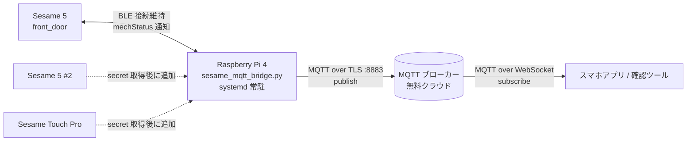
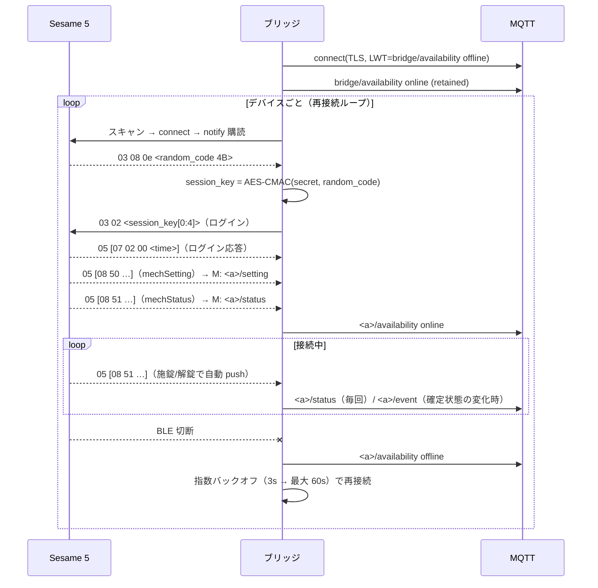

# Sesame 5 → MQTT ブリッジ 設計書

最終更新: 2026-10-07

## 1. 目的

玄関の Sesame 5 の施錠・解錠を Raspberry Pi 4 が BLE で検知し、MQTT ブローカーへ publish する。
スマホアプリは MQTT を購読するだけで、現在の状態と変化イベントを把握できる。

- 現時点の対象: 玄関の Sesame 5 × 2 台（上下）。
- 将来の対象: Sesame Touch Pro（secret を取得後に `config.json` へ追加するだけ）

## 2. 構成



| 要素 | 実体 | 役割 |
|---|---|---|
| Sesame 5（alias `front_door`） | `FA:EE:B1:3F:13:0F` | 施錠・解錠のたびに mechStatus を BLE 通知で push |
| Sesame 5 B（alias `sesame5_b`） | `CC:AC:29:15:5A:E6` | 同上。2026-10-07 に QR から secret を取得して追加 |
| Raspberry Pi 4 | `chengRasp`（IPv6 のみ、Raspberry Pi Connect 有効） | BLE 接続を維持し、通知を MQTT に変換 |
| MQTT ブローカー | 試験: `broker.emqx.io:8883`（公開、TLS）<br/>本番候補: HiveMQ Cloud / EMQX Cloud の無料枠（認証付き） | メッセージ中継、retained による現在状態保持 |
| 購読側 | `pi/mqtt_watch.py`（PC）、将来はスマホアプリ | 現在状態の表示、イベント受信 |

## 3. リポジトリ構成（`pi/`）

| ファイル | 内容 | git |
|---|---|---|
| `sesame_protocol.py` | Sesame OS3 BLE プロトコル（鍵導出、AES-CCM、mechStatus 解析、スキャン、1 回限りの状態取得） | 管理 |
| `sesame_status.py` | 手動確認 CLI（スキャン、状態取得、オフライン自己検証） | 管理 |
| `sesame_mqtt_bridge.py` | 常駐ブリッジ本体 | 管理 |
| `mqtt_watch.py` | 購読確認ツール | 管理 |
| `sesame-bridge.service` | systemd ユニット | 管理 |
| `deploy.sh` | Pi への配備（ssh 経路 / Pi Connect 貼り付け経路） | 管理 |
| `mqtt_push.py` / `mqtt_pull.py` | ssh 不達時の配備。コードを tar.gz で MQTT に載せ、Pi 側で SHA-256 照合して展開 | 管理 |
| `remote_control.py` / `authz.py` / `authz_admin.py` / `remote_cmd.py` | 遠隔施解錠（`REMOTE_UNLOCK_DESIGN.md`） | 管理 |
| `sesame_cmd.py` | 施錠・解錠の検証用 CLI（ブリッジ停止中のみ） | 管理 |
| `authz.json` / `nonces.db` / `audit.log` / `keys/` | 権限表・nonce・監査ログ・秘密鍵 | **管理外** |
| `config.example.json` | 設定の雛形（プレースホルダ） | 管理 |
| `config.json` | **実設定。device secret・MQTT 認証・トピック接頭辞を含む** | **管理外（.gitignore）** |

`src/` 配下は ESP32（MicroPython）向けの別系統の雛形で、本ブリッジとは独立している。

## 4. 秘密情報の扱い

- device secret はソースコードに書かない。`pi/config.json` のみに置き、`.gitignore` で除外する。
- `refSource/` の参考コードからも直書きを除去済み。ただし **過去のコミット履歴には残っている**。公開リポジトリにするなら履歴の書き換え（`git filter-repo`）か、Sesame アプリで鍵を再発行して secret を無効化すること。
- MQTT には MAC アドレスや secret を出さず、別名（alias）だけを使う。
- 公開ブローカーは誰でも購読できるため、トピック接頭辞に 96bit のランダム値を含めて推測不能にする。これは**試験用の暫定策**で、本番は認証付きブローカーに移す（§9）。

## 5. 設定（`config.json`）

```json
{
  "mqtt": {
    "host": "broker.emqx.io", "port": 8883, "tls": true,
    "username": null, "password": null,
    "client_id": "sesame-bridge-chengrasp",
    "topic_prefix": "sesame/<RANDOM_HEX_24>", "qos": 1
  },
  "devices": [
    { "alias": "front_door", "mac": "FA:EE:B1:3F:13:0F", "secret": "<DEVICE_SECRET_HEX_32>" }
  ],
  "ble": {
    "scan_timeout_sec": 20, "connect_timeout_sec": 20,
    "reconnect_min_sec": 3, "reconnect_max_sec": 60,
    "status_republish_sec": 0
  },
  "log_level": "INFO"
}
```

- `devices[]` に追加するだけで複数台に対応する（台数分の BLE 接続を並行して維持する）。
- `name` はアプリで付けた鍵の名前。BLE からは取れない（名前は CandyHouse クラウドとアプリにしかない）ので、「鍵をシェア」リンクの `n=` パラメータから `parse_share_url.py` で取り出して保存する。詳細は §8.6。
- 認証付きブローカーへ移すときは `host / port / username / password` を書き換えるだけでよい。

## 6. MQTT トピックとペイロード

`<p>` = `topic_prefix`、`<a>` = デバイスの alias。すべて QoS 1。

| トピック | retained | 送信タイミング | 内容 |
|---|---|---|---|
| `<p>/bridge/availability` | ○ | ブリッジ起動時 `online`、終了・異常終了時 `offline`（LWT） | ブリッジの死活 |
| `<p>/bridge/heartbeat` | ○ | 60 秒ごと | 稼働時間、MQTT 接続状態、各デバイスの BLE 接続状態と最終確定状態 |
| `<p>/<a>/availability` | ○ | BLE 接続確立・切断時 | `online` / `offline` |
| `<p>/<a>/status` | ○ | mechStatus 通知のたび（`status_republish_sec` > 0 なら定期再送も） | 現在状態（下記） |
| `<p>/<a>/setting` | ○ | ログイン直後に届く mechSetting 受信時 | 施錠位置、解錠位置、オートロック秒数 |
| `<p>/<a>/event` | × | 確定状態（LOCKED/UNLOCKED）が**変わったときだけ** | 遷移イベント（下記）。遠隔操作由来なら `by` にユーザー ID |
| `<p>/<a>/cmd` | × | アプリ → ブリッジ | 署名付きコマンド（`REMOTE_UNLOCK_DESIGN.md` §5） |
| `<p>/<a>/cmd/result/<req_id>` | × | コマンド処理後 | 実行結果 |
| `<p>/bridge/authz` | ○ | 起動時と 60 秒ごと | 遠隔操作の有効状態、ユーザー数、許可操作（秘密を含まない） |

### 6.1 `status` ペイロード

```json
{
  "alias": "front_door",
  "name": "玄関 下",              // アプリで付けた名前（config.json の name。シェアリンクの n= 由来）
  "state": "LOCKED",            // LOCKED | UNLOCKED | MOVING/UNKNOWN
  "locked": true,
  "battery_pct": 77,            // 電圧→残量の目安（§8.4）
  "voltage": 5.72,
  "battery_critical": false,
  "position": -1,               // サムターン角度
  "target": -32768,             // 目標角度（-32768 = 目標なし）
  "flags": 18,                  // 生のフラグ（§8.3）
  "last_change_ts": "2026-10-07T02:36:49+00:00",
  "ts": "2026-10-07T02:41:49+00:00",
  "seq": 12
}
```

### 6.2 `event` ペイロード

```json
{
  "alias": "front_door",
  "event": "unlocked",          // locked | unlocked
  "from": "locked",
  "position": -92,
  "battery_pct": 77,
  "ts": "2026-10-07T02:47:14+00:00"
}
```

### 6.3 設計判断

- **retained を使う理由**: 購読した瞬間に現在状態が届くので、アプリ側で「状態取得 API」を別途用意しなくてよい。
- **status と event を分ける理由**: status は動作中（MOVING）も含めて何度も届く。アプリの通知は「確定状態の変化」だけで十分なので event に分離した。起動直後の初回状態は変化ではないのでイベントにしない。
- **定期再送は既定で無効**（`status_republish_sec: 0`）。retained があるので再送しなくても購読側は最新状態を得られる。ブリッジの生存確認は `bridge/heartbeat`（60 秒）と `availability`（LWT）で行う。`ts` の鮮度で判断したい場合だけ正の値にする。
- **切断中のバッファ**: MQTT 未接続時は retained 状態を保持し、イベントは最大 200 件キューに溜めて再接続時に送る。

## 7. ブリッジの動作



- 再接続のたびに Sesame は新しい random_code を配るので、セッション鍵と送受信カウンタを作り直す（`SesameSession` を接続ごとに生成）。
- 1 台ごとに独立した asyncio タスクで接続を維持する。1 台が失敗しても他に影響しない。
- SIGTERM / SIGINT で `availability offline` を送ってから終了する。
- 施錠・解錠コマンドの送信機能は持たない（読み取り専用）。遠隔操作は `REMOTE_UNLOCK_DESIGN.md` の設計に従って追加する。

## 8. Sesame OS3 BLE プロトコル（実機で確認済みの範囲）

`refSource/s5WinApp.py` と `refSource/log.txt`、および 2026-10-07 の実機接続で確認した内容。

### 8.1 GATT

| 用途 | UUID |
|---|---|
| コマンド書き込み（Write Without Response） | `16860002-a5ae-9856-b6d3-dbb4c676993e` |
| 状態通知（Notify） | `16860003-a5ae-9856-b6d3-dbb4c676993e` |

アドバタイズの manufacturer data（会社 ID `0x055A`）: `productModel(u16 LE)`, `isRegistered(u8)`, …
productModel 5 = Sesame 5、9 = Sesame Touch Pro。

### 8.2 パケット形式

```
[seg 1B][op 1B][item 1B][payload …]
seg  = 0x03: 平文 / 0x05: 暗号文（op 以降が AES-CCM で暗号化、末尾 4B がタグ）
op   = 0x07: 応答（response） / 0x08: 自発通知（publish）
item = 0x02 login / 0x04 history / 0x05 version / 0x0e initial(random_code)
       0x50 mechSetting / 0x51 mechStatus / 0x52 lock / 0x53 unlock
```

暗号:

- `session_key = AES-CMAC(device_secret, random_code)`（16B）
- `AES-CCM(session_key, nonce = counter(9B LE) ‖ random_code(4B), AAD = 0x00, tag = 4B)`
- 送信・受信で別々のカウンタを 0 から数える。接続ごとにリセット。
- ログイン: `03 02 ‖ session_key[0:4]`

### 8.3 mechStatus（item 0x51）payload

```
battery(u16 LE) target(i16 LE) position(i16 LE) flags(u8)
flags: bit0 clutch_failed, bit1 in_lock_range, bit2 in_unlock_range,
       bit3 critical, bit4 stopped, bit5 battery_critical, bit6 clockwise
state = LOCKED if in_lock_range else UNLOCKED if in_unlock_range else MOVING/UNKNOWN
```

実測例: `fb0b 0080 0300 12` → 6.13V、位置 3°、flags 0x12 = LOCKED。`… a4ff 54` → 位置 -92°、UNLOCKED。

### 8.4 電池

`voltage = battery × 2 / 1000`（CR123A × 2 直列）。残量 % は CandyHouse SDK の換算表を線形補間した目安。

### 8.5 mechSetting（item 0x50）payload

`lock_position(i16) unlock_position(i16) auto_lock_sec(u16)`。実機: 施錠 0°、解錠 -85°、オートロック無効。

### 8.6 鍵の「名前」はどこにあるか（2026-10-07 調査）

公式リポジトリ `CANDY-HOUSE/API_document`（BLE/REST 仕様）と `CANDY-HOUSE/SesameSDK_Android_with_DemoApp`（公式アプリと同一コード）を確認した結果:

- **錠本体には名前は保存されていない。** BLE の全コマンド（login / mechStatus / mechSetting / history …）に名前フィールドは無い。アドバタイズ名はデバイス UUID 由来の固定値。
- **名前は CandyHouse クラウド上のユーザーアカウントの鍵レコードにある。** 公式アプリは Web 層（H5）がクラウドから鍵一覧を取得し、ネイティブ側 `BleController.accept(rows)` に `deviceUUID / deviceModel / deviceName / keyIndex / secretKey / sesame2PublicKey` を渡す。`deviceName` は鍵レコードの `historyTag` として保持され、表示名は `deviceName(device) = key.historyTag ?: productModel.deviceModelName()`（名前未設定なら機種名）。
- **公開 Web API（x-api-key）では取れない。** `GET /api/sesame2/{uuid}`（状態）、`/history`、`POST /cmd` の 3 つだけで、応答に名前フィールドは無い。
- **鍵をシェアする QR / `ssm://` リンクの `n=` が、アプリの `deviceName` をそのまま載せたもの。** これが外部から名前を得る唯一の文書化された経路。アカウント認証付きの内部 API（アプリが使う鍵一覧）は非公開で、利用は想定されていない。

結論: `config.json` の `name` に QR 由来の名前を保存して使うのが正解。表示が `front_door` のように alias になっているデバイスは、QR 未取得で名前が入っていないだけ。

## 9. ブローカー

### 9.1 試験（現在）

- `broker.emqx.io:8883`（TLS、認証なし、公開）。代替: `broker.hivemq.com:8883`。
- スマホ側は WebSocket: `wss://broker.emqx.io:8084/mqtt`。
- 公開ブローカーのため、retained メッセージを含めて誰でも読める。トピック接頭辞のランダム値だけが防御。**ドアの施錠状態を長期間置く用途には使わない。**

### 9.2 本番候補（無料枠、要サインアップ）

| サービス | 無料枠 | 備考 |
|---|---|---|
| HiveMQ Cloud Serverless | 100 接続、10GB/月 | TLS 必須、ユーザー名/パスワード認証、WebSocket あり |
| EMQX Cloud Serverless | 100 万セッション分/月 | 同上 |

切り替えは `config.json` の `mqtt` セクションだけ。サインアップはユーザー自身が行う。

## 10. 配備と運用

### 10.1 Pi への到達

- ssh: `cheng@240b:10:ef27:ab00:dea6:32ff:feab:7777`（IPv6 のみ。Mac 側に IPv6 がないと不達）
- 代替: Raspberry Pi Connect の Remote shell（ブラウザ）。`deploy.sh clip` でクリップボードに作った base64 ヒアドキュメントを貼り付けて展開する。

### 10.2 Pi 側の前提

- Raspberry Pi OS（Debian 13 系、Python 3.13）、`pip3 install --user --break-system-packages bleak pycryptodome paho-mqtt`（2026-10-07 導入済み）
- 配備先: `/home/cheng/sesame-bridge/`（2026-10-07 配備済み。初回は `nohup` で起動、systemd 登録は未実施）
- Bluetooth アダプタ `hci0` は起動時に rfkill でソフトブロックされていることがある。`rfkill unblock bluetooth` は root 不要で通る（ユニットの `ExecStartPre` に組み込み済み）。
- `sudo` はパスワード必須。systemd のシステムサービス登録はユーザーが手動で行う:

```bash
cd ~/sesame-bridge
sudo cp sesame-bridge.service /etc/systemd/system/
sudo systemctl daemon-reload
sudo systemctl enable --now sesame-bridge
journalctl -u sesame-bridge -f
```

### 10.3 更新手順

```bash
# Mac から（ssh が通るとき）
PI_PASS=... pi/deploy.sh ssh --restart
# ssh が通らないとき
pi/deploy.sh clip   # → Pi Connect の Remote shell に貼り付け → sudo systemctl restart sesame-bridge
```

### 10.4 監視の見方

- `bridge/availability` が `offline` → Pi またはブリッジ停止（LWT）。
- `<a>/availability` が `offline` → Pi は生きているが Sesame に BLE 接続できていない（電波、電池切れ、同時接続上限）。
- `<a>/status.ts` は最後に状態通知を受けた時刻（既定では定期再送なし）。鮮度の判断には `bridge/heartbeat.ts` を使う。

## 11. 購読側（スマホアプリ）の指針

1. まずは汎用 MQTT クライアント（MQTT Explorer、MQTT Dash 等）で `<p>/#` を購読して動作確認する。
2. 専用アプリは `<a>/status` の retained を初期表示に使い、`<a>/event` で変化を通知する。
   - **アプリがオフラインだった間の最新状態**: retained により、再接続・購読した瞬間にブローカーが保持している最後の `status` が届く。アプリ側に特別な実装は不要。
   - **オフライン中のイベント履歴**まで欲しい場合は、retained では最後の 1 件しか残らないので、アプリ側で永続セッション（`clean_session=false` + QoS 1、固定 client_id）を使う。ブローカーがそのクライアント宛の未配信メッセージをキューに溜める（公開ブローカーでは保持期間が短いことがある）。確実に残すならサーバー側で履歴を蓄積する。
3. **バックグラウンド通知が必要なら MQTT 購読だけでは不足**（特に iOS はフォアグラウンド限定）。サーバー側で MQTT を受けて ntfy / FCM / APNs に転送する小さな中継を置く。
4. 「誰が開けたか」は Sesame の履歴（item 0x04）で取れる見込み。必要なら event に `by: fingerprint | app | manual` を追加する（未実装）。

## 12. 既知の制約・未確認事項

- Sesame 5 の BLE 同時接続数。ブリッジが接続を保持している間も Sesame アプリや Touch Pro が使えることは仕様上期待できるが、実運用で確認する。
- Sesame が長時間アイドルの central を切断するかどうか。切断されても再接続ループで復帰するが、頻度が高いと `availability` が揺れる。
- 電池残量 % は換算表による目安。
- 公開ブローカー利用中はメッセージが第三者に見える可能性がある（§4、§9.1）。

## 12.1 2 台目以降の追加手順

1. Sesame アプリで対象の鍵 → 「鍵をシェア」→ 表示されたリンク（`ssm://UI?t=sk&sk=…&n=名前`）をコピーする（QR を任意のリーダーで読んでも同じ文字列が得られる）。
2. `python3 pi/parse_share_url.py '<リンク>' --mac <BLE MAC> --alias <英数字の別名> --save` で `config.json` に追加する。
   - Sesame 5（OS3）の `sk` は 39 バイト: `[0] productModel, [1:17] secret, [17:19] 鍵番号, [19:35] デバイス UUID`。
   - MAC の特定: QR 内のデバイス UUID の後半 12 バイトに `ff×4` を付けて base64 したものが、その鍵の BLE アドバタイズ名になる（実機で確認）。`parse_share_url.py` が「BLE 名」として表示するので、`sesame_status.py --scan-only` の `name` と一致する MAC を選ぶ。
   - QR 画像（アプリのスクリーンショット）を `parse_share_url.py` にそのまま渡せば OpenCV で読み取る。
3. `python3 pi/sesame_status.py` でログインして状態が取れることを確認する（secret が違えば mechStatus が届かない）。
4. `pi/deploy.sh` で Pi に配備し、ブリッジを再起動する。

## 13. 今後の拡張

- 残り 2 台（Sesame 5 #2、Touch Pro）の secret 取得と追加
- 履歴（item 0x04）の解析による操作主体の付与
- 認証付きブローカーへの移行、プッシュ通知中継
- MQTT 経由の遠隔施解錠 → 設計書 `REMOTE_UNLOCK_DESIGN.md`（権限モデル、署名、再送防止、安全装置）
- スマホアプリ（Flutter / React Native、MQTT over WebSocket）
- 必要なら ESP32 版（`src/` と `refSource/AES_CCM.py` を土台に BLE 暗号を MicroPython で実装）
